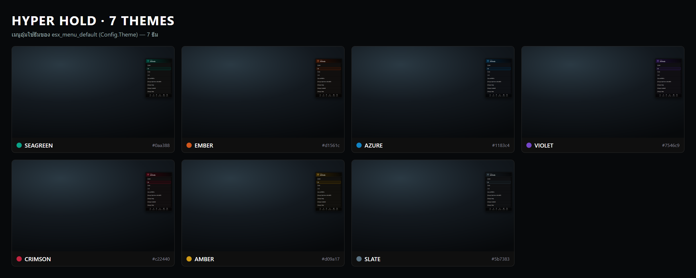
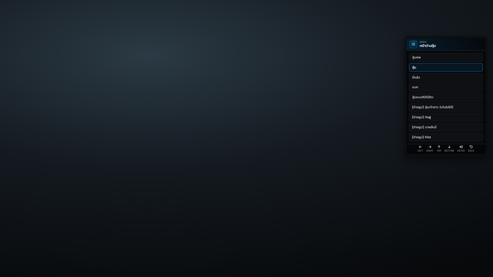
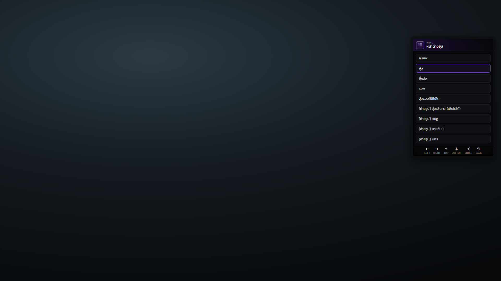
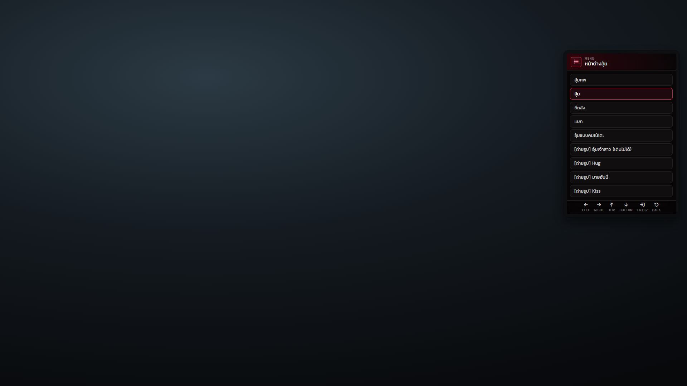
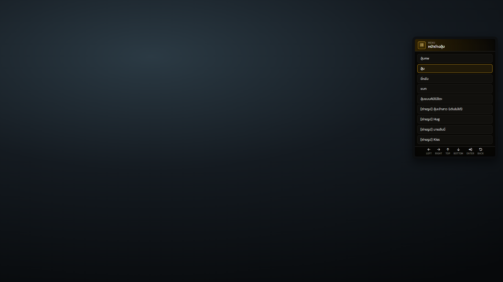
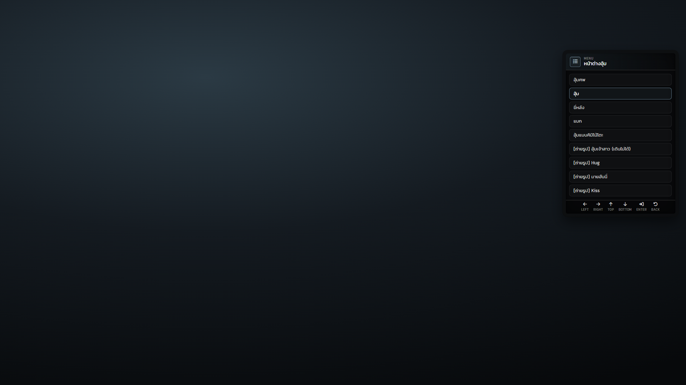

# ธีมสี

Hyper_Hold ไม่มีธีมของตัวเอง เมนูอุ้มใช้ธีมตาม `Config.Theme` ของ **esx_menu_default** ซึ่งมี 7 ธีม (ตอนนี้ตั้งเป็น `seagreen`) ส่วนแจ้งเตือนใช้ธีมของ Hyper_Notifyall ซึ่งตั้งเป็น `seagreen` เช่นกัน



| ธีม | สีหลัก (accent) | สีสว่าง (accent-hi) | สีเข้ม (primary) | พื้นแผง |
| --- | --- | --- | --- | --- |
| seagreen (ค่าเริ่มต้น) | `#0aa388` | `#16c7a6` | `#07705f` | `#0f0f0f` |
| ember | `#d1561c` | `#ff7a3d` | `#8f3410` | `#100d0c` |
| azure | `#1183c4` | `#35a8ee` | `#0a4f7a` | `#0b0e13` |
| violet | `#7546c9` | `#9a6ff0` | `#4a2a86` | `#0e0c13` |
| crimson | `#c22440` | `#f04a66` | `#7a1226` | `#100b0d` |
| amber | `#d09a17` | `#f5bf3d` | `#8a6410` | `#0f0e09` |
| slate | `#5b7383` | `#83a0b2` | `#35434c` | `#0c0e10` |

## เปลี่ยนธีม

```lua
-- resources/[Esx]/[Menu]/esx_menu_default/config.lua
Config.Theme = 'violet' -- seagreen | ember | azure | violet | crimson | amber | slate
```

ธีมเปลี่ยนสีกรอบของรายการที่เลือก ไอคอนหัวเมนู และแถบไล่สีหัวเมนู ส่วนกรอบดำ สีตัวอักษร และสีแดงของ error (`#e25656`) ไม่เปลี่ยน


ธีมนี้มีผลกับทุกเมนู ESX ในเซิร์ฟ ไม่ใช่เฉพาะเมนูอุ้ม ถ้าใส่ชื่อธีมที่ไม่มีอยู่ ระบบจะกลับไปใช้ seagreen


## ภาพทีละธีม

### seagreen


### ember


### azure



### violet



### crimson



### amber



### slate


