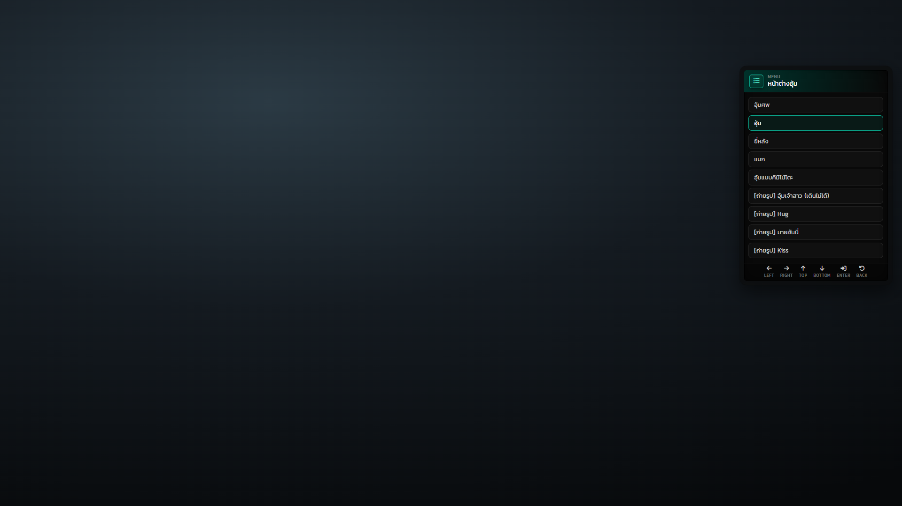
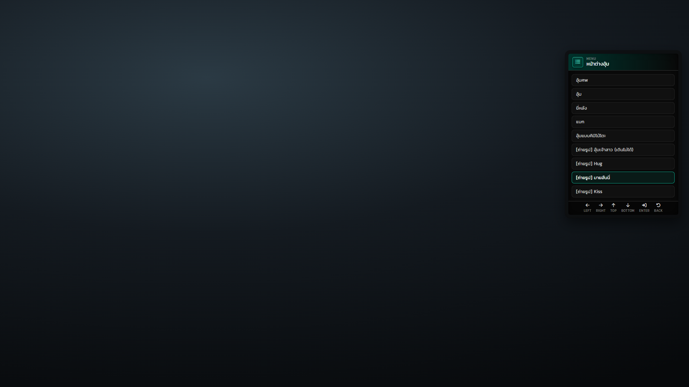
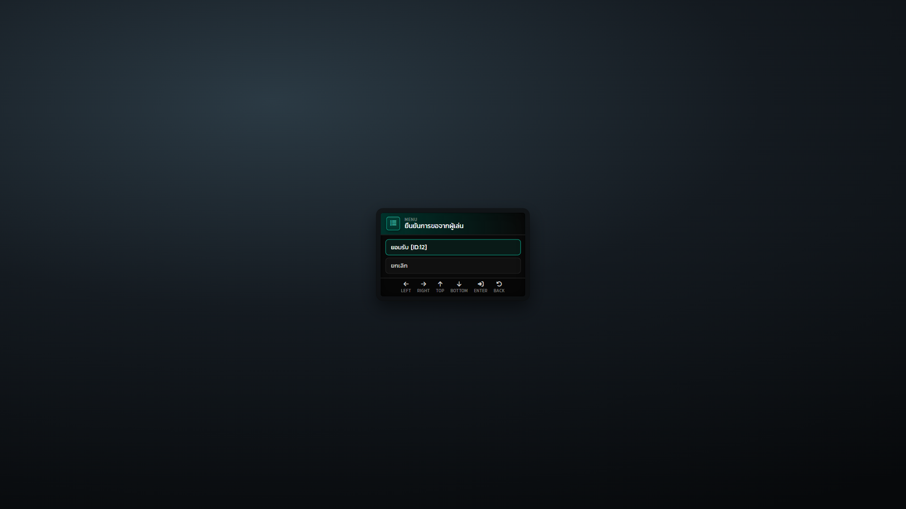
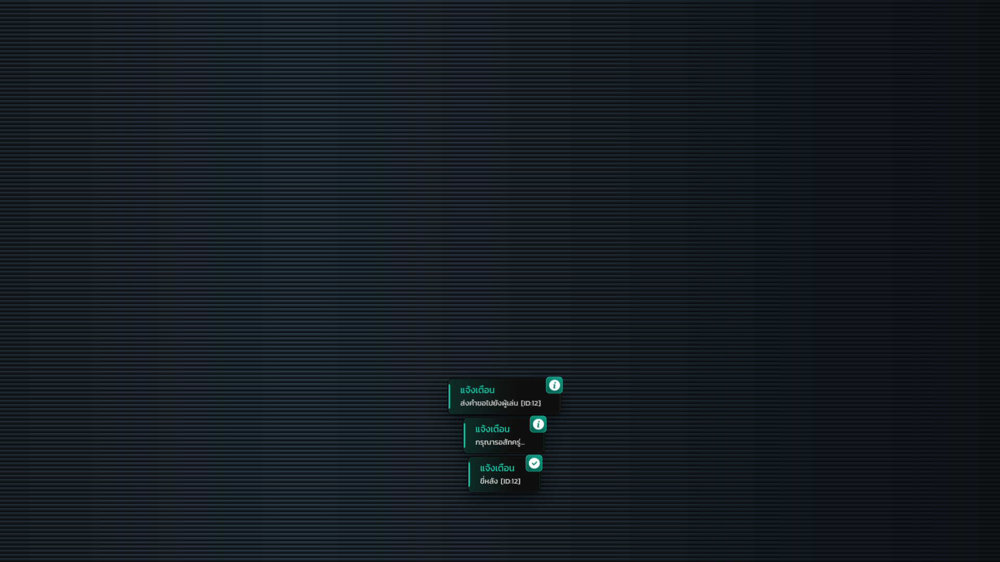
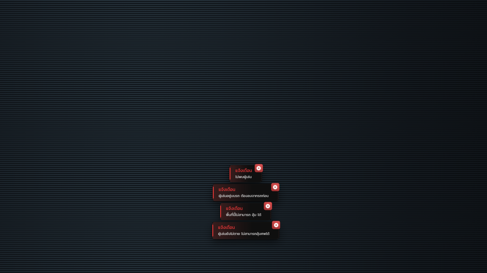
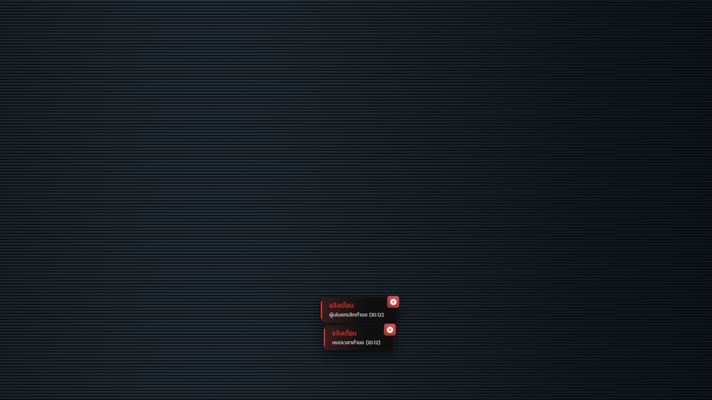

# หน้าจอ UI แต่ละโหมด

Hyper_Hold ไม่มี NUI ของตัวเอง เมนูใช้ `ESX.UI.Menu` แบบ `default` ซึ่ง esx_menu_default เป็นตัววาด ส่วนแจ้งเตือนใช้ `exports["Hyper_Notifyall"]:sendNotify` ที่ตำแหน่ง `bottomCenter`
ทุกภาพถ่ายจากโค้ด NUI จริงของสอง resource นี้ โดยส่งข้อมูลแบบเดียวกับที่ Hyper_Hold ส่ง ส่วน ID ผู้เล่นในภาพเป็นข้อมูลจำลอง

| # | โหมด | ใครเห็น | มาจาก |
| --- | --- | --- | --- |
| 1 | เมนูอุ้ม | คนอุ้ม (กด F9) | esx_menu_default |
| 2 | เมนูอุ้ม: ท่าถ่ายรูป | คนอุ้ม | esx_menu_default |
| 3 | ยืนยันคำขอ | คนถูกอุ้ม | esx_menu_default |
| 4 | เมนูยกเลิก | ทั้งสองฝั่งระหว่างอุ้ม | esx_menu_default |
| 5 | แจ้งเตือนขั้นตอนอุ้ม | คนอุ้ม | Hyper_Notifyall |
| 6 | แจ้งเตือนเมื่ออุ้มไม่ได้ | คนอุ้ม | Hyper_Notifyall |
| 7 | แจ้งเตือนผลคำขอ | คนอุ้ม / ทั้งสองฝั่ง | Hyper_Notifyall |

## 1. เมนูอุ้ม (F9)

เมนู "หน้าต่างอุ้ม" อยู่มุมขวาบน (`Config.MenuAlign = "top-right"`) มี 9 ท่า ในภาพเลือก "อุ้ม" อยู่ แถบล่างแสดงปุ่มลูกศร Enter และ Back

## 2. เมนูอุ้ม: ท่าถ่ายรูป

ท่าที่ขึ้นต้นด้วย [ถ่ายรูป] มี 4 ท่าและอยู่ท้ายรายการ ในภาพเลือก "[ถ่ายรูป] มายฮันนี่"

## 3. ยืนยันคำขอ (ฝั่งคนถูกอุ้ม)

เมนูกลางจอ "ยืนยันการขอจากผู้เล่น" มีตัวเลือก "ยอมรับ [ID:12]" และ "ยกเลิก" ถ้าไม่ตอบภายใน 10 วินาที เมนูจะปิดเอง และการกด Back ถือว่าปฏิเสธ

## 4. เมนูยกเลิก (ระหว่างอุ้ม)

เมื่อกด F9 ระหว่างอุ้ม เมนูจะเหลือตัวเลือกเดียวคือ "ยกเลิก [ID]" คนถูกอุ้มจะเห็นเมนูนี้เฉพาะเมื่อท่าและอาชีพของคนอุ้มอนุญาตให้ยกเลิกเองได้

## 5. แจ้งเตือนขั้นตอนอุ้ม

แจ้งเตือนที่คนอุ้มเห็นตามลำดับ เริ่มจาก "ส่งคำขอไปยังผู้เล่น" (info) ต่อด้วย "กรุณารอสักครู่..." (info) และ "ขี่หลัง [ID:12]" (success) ในภาพนำมาเรียงพร้อมกัน แต่ในเกมจะขึ้นทีละอัน อันละ 1.5 วินาที

## 6. แจ้งเตือนเมื่ออุ้มไม่ได้

แจ้งเตือนสีแดงมี 4 กรณี คือ ไม่พบผู้เล่น ผู้เล่นอยู่บนรถ อยู่ในโซนห้ามอุ้ม และอุ้มศพคนที่ยังไม่ตาย

## 7. แจ้งเตือนผลคำขอ

คนอุ้มจะได้รับแจ้งเตือนเมื่ออีกฝ่ายปฏิเสธ และเมื่อคำขอหมดเวลา ทั้งสองฝั่งจะได้รับแจ้งเตือน


ข้อความ 3D "กด [E] ฆ่าตัวประกัน" และท่าอุ้มทั้ง 10 แบบเป็นภาพที่เกมวาดเอง จึงถ่ายจาก NUI ไม่ได้ ต้องแคปจากในเกม

